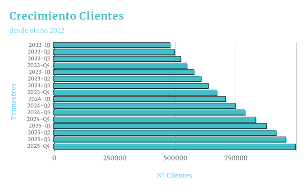
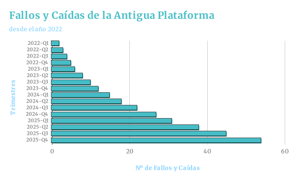
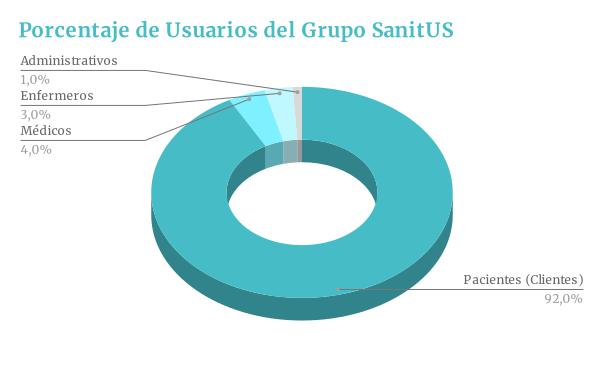

# Gestión del Grupo Sanitario Privado SanitUS

> ### 👤​ Miembros del grupo L4 (FJO)
>
>Suárez Masero, Victor \
>Jiménez Bermúdez, Francisco José \
>Pérez Olivera, Marcos \
>Álvarez de la Maya, Rafael

>[!WARNING] 
>Para una correcta visualización no abrir el README en un IDE, mirar siempre desde GitHub
********************************************************

## 🏥 Introducción al Problema 

Nos han contactado el grupo de hospitales privados **SanitUS**, debido a su costante crecimiento, su actual sistema de gestión se ha quedado obsoleto y lento. SanitUS es un grupo que opera a nivel nacional en España teniendo como centros principales **Hospitales** y **Centros Médicos** de día, en cuanto a su personal los usuarios que usaran la plataforma serían sus **médicos**, sus **enfermeros**, obviamente los **clientes** y el **personal de administración**. 

 
 

## 📖​ Glosario de términos

- Términos específicos del dominio del problema, ordenados alfabéticamente. Se valorará la presencia de información multimedia.

## 👁️​ Visión general del sistema

|**Requisitos generales**| Descripción|
|:-----------------:|:--|
| **Gestión de Citas y Agenda** |El sistema debe de permitir  gestionar la agenda del personal sanitario para organizarla y dar cita a los pacientes.A su vez estos deben de tener la posibilidad de solicitar una cita eligiendo personal,fecha... |
| **Gestión de ingresos médicos** | El sistema tiene que implementar una función que permita el seguimiento de los ingresos y las altas de los pacientes.|
| **Gestión de Historiales** | El sistema debe guardar y mostrar al personal sanitario el historial de cada cliente (citas, ingresos, informacion relevante...)|
| **Consultar Información** | La plataforma debe poder prestar su informacion a cada paciente así como sus citas pendientes y el personal sanitario que le atiende. |

 | **Usuarios del sistema** | Descripción|
 |:--:|:--|
 | **Médicos** | Personal Sanitario que atiende a los pacientes en consulta o en habitaciones, apoyandose en enfermeros cuando haga falta. |
 | **Enfermeros** | Personal Sanitario que se encarga de asistir a los médicos y de realizar pruebas rutinarias (curas,vacunación,extracciones de sangre...)|
 | **Administrativo** | Usuarios encargados de agendar las citas e ingresos al personal sanitario y atender administrativamente a los pacientes|
 | **Pacientes** | Cliente del grupo que puede consultar su información y pedir citas (grupo mayoritario)|

<!--Todos estos usuarios podrán acceder al sistema con sus credenciales (email,contraseña y dni).-->
## 📜​ Catálogo de requisitos

### ⚒️ Requisitos funcionales

#### R.F.01. Acceso a Historiales Médicos
>
>Como Médico \
>quiero poder buscar, acceder y añadir al historial médico de un paciente\
>para poder diagnosticar y tener conocimiento del historial previo del paciente
>
>**Prueba de aceptación**
>- Teniendo algún historial en el sistema poder probar desde la interfaz del médico si puede buscar los historiales.
>- Teniendo algún historial en el sistema poder probar desde la interfaz del médico si puede editar y acceder a los mismos.
>- Se debe aplicar la regla de negocio R.N.XX. 

#### R.F.02. Solicitud de Pruebas a Enfermería
>
>Como Médico \
>quiero poder solicitar que un enfermero realice una prueba a un determinado paciente \
>para poder diagnosticar enfermedades y realizar un seguimiento del paciente.
>
>**Prueba de aceptación**
>- Mandar una prueba desde el interfaz del médico y que aparezca en el listado de pruebas rutinarias de enfermería.
>- Comprobar que cuando una prueba se actualiza en enfermería, el médico pueda acceder a los resultados.
>- Se debe aplicar la regla de negocio R.N.XX.
 
#### R.F.03. Vista del Cliente
>
>Como Paciente \
>quiero poder acceder a mi lista de citas \
>para poder solicitar, cancelar y consultar las citas médicas que tenga asociadas a mi usuario
>
>**Prueba de aceptación**
>- Probar a cancelar una cita, que cambie de estado y desaparezca de la agenda del médico y del paciente
>- Probar a agendar una cita, que permita elegir la fecha y el médico, y aparezca en la agenda del médico y del paciente
>- Se debe aplicar la regla de negocio R.N.XX.

#### R.F.04. Acceso a Informes desde el lado Cliente
>
>Como Paciente \
>quiero poder acceder a mi información \
>para poder consultar toda la información y el historial médico asignado a mi usuario.
>
>**Prueba de aceptación**
>- Probar desde la interfaz del paciente a acceder al historial médico.
>- Probar desde la interfaz del paciente que en dicho historial aparezcan las últimas citas agendadas, así como los últimos cambios del mismo.
>- Se debe aplicar la regla de negocio R.N.XX.

#### R.F.05. Modificación de Fichas Personales
>
>Como Administrativo \
>quiero poder editar las fichas de datos personales de todos los usuarios \
>para poder mantener actualizada la base de datos.
>
>**Prueba de aceptación**
>- Probar desde la interfaz del paciente a acceder al historial médico.
>- Probar desde la interfaz del paciente que en dicho historial aparezcan las últimas citas agendadas, así como los últimos cambios del mismo.
>- Se debe aplicar la regla de negocio R.N.XX.

#### R.F.06. Registro de Nuevos Usuarios
>
>Como Administrativo \
>quiero poder registrar nuevos usuarios\
>para poder dar de alta a pacientes, médicos o enfermeros.
>
>**Prueba de aceptación**
>- Probar desde la interfaz del administrativo que se crea un nuevo perfil de usuario según el rol asignado
>- Se debe aplicar la regla de negocio R.N.XX.

#### R.F.07. Agenda para Enfermeros
>
>Como Enfermero \
>quiero poder ver la agenda \
>para poder tener conocimiento de cuando debo acudir con un médico asignado o realizar mis tareas en el ala de enfermería.
>
>**Prueba de aceptación**
>- Probar desde la interfaz del enfermero que salga la agenda
>- Probar desde la interfaz del enfermero que no se solapen tareas en la misma franja horaria
>- Se debe aplicar la regla de negocio R.N.XX.

#### R.F.08. Agenda para Médicos
>
>Como Médico \
>quiero poder ver la agenda \
>para poder tener conocimiento de los pacientes que tengo que atender día a día.
>
>**Prueba de aceptación**
>- Probar desde la interfaz del médico que salga la agenda
>- Probar desde la interfaz del médico que no se solapen las citas / visitas a ingresos en una misma franja horaria.
>- Se debe aplicar la regla de negocio R.N.XX.

#### R.F.09. Recordatorio de Agenda
>
>Como Administrativo \
>quiero que les llegue un recordatorio a los pacientes con 24 horas de antelación \
>para poder evitar que no acudan a las citas por descuidos.
>
>**Prueba de aceptación**
>- Probar desde la interfaz del paciente que llegue el recordatorio
>- Se debe aplicar la regla de negocio R.N.XX.

#### R.F.10. Disponibilidad 24/7
>
>Como Dueño de la empresa \
>quiero que la plataforma esté activa 24/7 \
>para poder trabajar y ofrecer nuestros servicios en cualquier momento.
>
>**Prueba de aceptación**
>- Probar que el servidor esté activo en todo momento y soporte una gran carga de solicitudes.
>- Se debe aplicar la regla de negocio R.N.XX.

#### ℹ️​ Requisitos de información

#### R.I.01 Información sobre las Citas
> 
> Como Administrativo quiero disponer de la siguiente información sobre las citas para organizar la atención de los pacientes:
> 
> - Paciente con el que esta enlazado la cita
> - El día y la hora de la cita  
> - El Centro Médico u Hospital asignado
> - El Departamento al que deberá acudir el paciente
> - El Médico asignado
> - Enfermero asignado (opcional)
> - El estado de la cita (Pendiente/Realizada/Cancelada)
>
> **Prueba de Aceptación**
> 
> - Crear una cita desde el panel de Administrativo.
> - Comprobar que al registrar una cita el sistema pide todos los datos.
> - Comprobar que una vez realizada la cita conserva todos sus datos.
> - Comprobar que la cita se agenda tanto para el personal sanitario como para el paciente.
> - Comprobar que una vez pasada la cita, esta cambia de Pendiente a Realizada
> - Comprobar que desde cualquiera de las partes la cita puede cancelarse y esta desaparece de la agenda de ambas partes.
#### R.I.02 Información sobre los Ingresos
> 
> Como Administrativo quiero disponer de la siguiente información sobre los ingresos para organizar la atención de los pacientes:
> 
> - Paciente que es ingresado
> - El día y la hora de ingreso  
> - El Centro Médico u Hospital asignado
> - El Médico asignado
> - Enfermero asignado (opcional)
> - El día y la hora de alta
> - Observaciones
>
> **Prueba de Aceptación**
> 
> - Crear un ingreso desde el panel de Administrativo.
> - Comprobar que al registrar un ingreso el sistema pide todos los datos.
> - Comprobar que una vez finalizado el ingreso se asigne el dia y hora de alta.
> - Comprobar que un medico puede poner observaciones durante el ingreso
> - Comprobar que las fechas sean válidas

#### R.I.03 Información Administrativa sobre los Pacientes
> 
> Como Administrativo quiero que el sistema me informe sobre los siguientes atributos del paciente
> 
> - Nombre y Apellidos
> - Documento Nacional de Identidad, NIE o Pasaporte
> - Domicilio
> - Email
> - Contraseña
> - Fecha de nacimiento
> - Fecha de defunción
> - Compañia de Seguro
> - Numero de Poliza
>
> **Prueba de Aceptación**
> 
> - Comprobar que cuando acceda al sistema se pueden observar todos sus datos

#### R.I.04 Información Médica sobre los Pacientes
> 
> Como Médico quiero que el sistema albergue los siguientes atributos del paciente
> 
> - Peso
> - Estatura  
> - Género
> - Alergias
> - Enfermedades diagnosticadas
> - Pruebas realizadas
> - Grupo Sanguineo
>
>
> **Prueba de Aceptación**
> 
> - Comprobar que cuando acceda al sistema se pueden observar todos sus datos

#### R.I.05 Información sobre los Médicos
> 
> Como dueño de la empresa quiero que el sistema albergue los siguientes atributos de los médicos
> 
> - Nombre y Apellidos
> - Documento Nacional de Identidad, NIE o Pasaporte
> - Domicilio
> - Email
> - Contraseña
> - Fecha de nacimiento
> - Cuenta bancaria
> - Numero de colegiado
> - Departamento
>
>
> **Prueba de Aceptación**
> 
> - Comprobar que cuando acceda al sistema se pueden observar todos sus datos

#### R.I.06 Información sobre los Enfermeros
> 
> Como dueño de la empresa quiero que el sistema albergue los siguientes atributos de los enfermeros
> 
> - Nombre y Apellidos
> - Documento Nacional de Identidad, NIE o Pasaporte
> - Domicilio
> - Email
> - Contraseña
> - Fecha de nacimiento
> - Cuenta bancaria
> - Numero de colegiado del enfermero
>
> **Prueba de Aceptación**
> 
> - Comprobar que cuando acceda al sistema se pueden observar todos sus datos

#### R.I.07 Información sobre los Administrativos
> 
> Como Médico quiero que el sistema albergue los siguientes atributos del paciente
> 
> - Nombre y Apellidos
> - Documento Nacional de Identidad, NIE o Pasaporte
> - Domicilio
> - Email
> - Contraseña
> - Fecha de nacimiento
> - Cuenta bancaria
>
>
> **Prueba de Aceptación**
> 
> - Comprobar que cuando acceda al sistema se pueden observar todos sus datos

#### 4.1.2. Reglas de negocio

##### R.N.01. Eliminación periódica de historiales antiguos
Si un paciente fallece, que el historial se borre después de 2 años debido a políticas de la empresa

##### R.N.02. Número máximo de citas por paciente
Solo está permitido que un paciente pueda tener como máximo tres citas agendadas en su perfil.

##### R.N.03. Periodo máximo de asignación de cita
Máximo de un periodo de 3 meses de antelación para una cita asignada por parte de un cliente

### 4.2. Mapa de historias de usuario (opcional)

### 4.3. Requisitos no funcionales (opcional)

**R.N.F. 01. Requisito No Funcional de Administrativo**
Como Administrativo
quiero poder modificar las citas de un paciente
para que los usuarios que tengan incidencias puedan ser atendidos. 

**R.N.F. 02. Requisito No Funcional de e**
Como Administrativo
quiero poder modificar las citas de un paciente
para que los usuarios que tengan incidencias puedan ser atendidos. 
-- fin entregable 1 --

<!--COMENTARIO

## 5. Modelo conceptual

### 5.1. Diagramas de clases UML

- con restricciones.

### 5.2. Escenarios de prueba

- con descripción textual y diagrama de objetos UML.

## 6. Matrices de trazabilidad

- Matriz de trazabilidad entre los elementos del modelo conceptual y los requisitos.

|       | EntidadX   | AsociaciónX  | RestricciónX  | Entidad2 ...   | 
|:------|:-----------|:-----------|:-----------|:-----------|
| RI-1  | X          | X          | X          | X          |
| RI-2  |            | X          |            | X          |
| RF-1  |            | X          |            | X          |
| RF-2  | X          |            | X          | X          |
| RN-1  |            | X          |            |            |
| RN-2  | X          | X          | X          |            |
| ...   |            |            |            |            |

-- fin entregable 2 --

## 7. Modelo relacional en 3FN

- Relaciones obtenidas al aplicar la transformación del modelo conceptual.

### 7.1.  Justificación de la estrategia de transformación de jerarquías

- si se identificaron jerarquías en el MC.

### 8. Matriz de trazabilidad MC/SQL (opcional):

- Restricciones sobre el MC / Elementos del modelo tecnológico (SQL) (Triggers, checks, etc.)
- Incluir Reglas de negocio — Constraints/Triggers en las matrices de trazabilidad para el entregable 3

|       | EntidadX   | AsociaciónX  | RestricciónX  | Entidad2 ...   | 
|:-------|:-------|:-------|:-------|:-------|
| TABLA-1 |        |        |        |        |
| TABLA-2 |        |        |        |        |
| TABLA-3 |        |        |        |        |
| TABLA-4 |        |        |        |        |
| TRIG-1 |        |        |        |        |
| TRIG-2 | X      | X      |        | X      |
| TRIG-3 |        | X      |        | X      |
| TRIG-4 |        |        | X      |        |
| CONST-1 |        |        |        |        |
| CONST-2 | X      | X      |        | X      |
| CONST-3 |        | X      |        | X      |
| CONST-4 |        |        | X      |        |

Se consideran todo tipo de constraints declarativas (aquellas definidas durante el CREATE TABLE).
-- fin entregable 3 --

## Referencias

